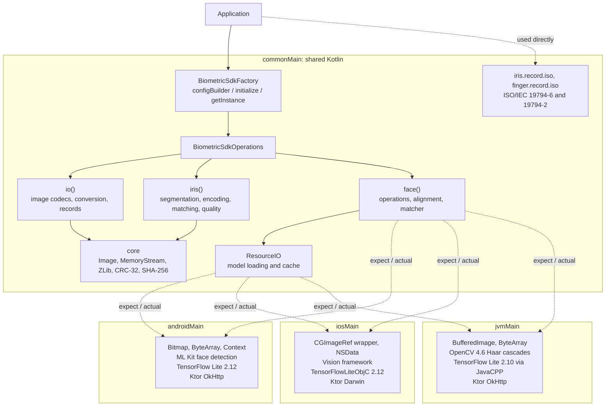
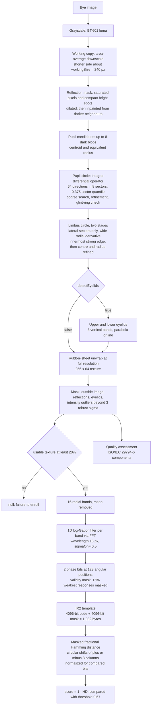
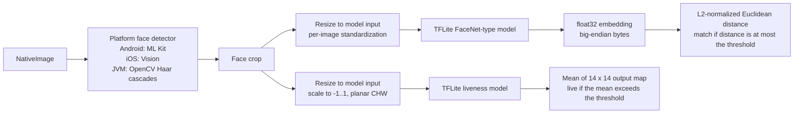

# Iriscan Biometric SDK


[](https://search.maven.org/search?q=g:%22net.iriscan%22%20AND%20a:%22biometric-sdk%22)
[](https://search.maven.org/search?q=g:%22net.iriscan%22%20AND%20a:%22biometric-sdk-jvm%22)
[](https://search.maven.org/search?q=g:%22net.iriscan%22%20AND%20a:%22biometric-sdk-android%22)
[](https://cocoapods.org/pods/BiometricSdk)
[](https://GitHub.com/biometric-technologies/biometric-sdk/releases/)

Biometric SDK is an open-source Kotlin Multiplatform library for biometric
recognition on Android, iOS and the JVM. It contains:

- **Iris recognition** written entirely in common Kotlin: segmentation, rubber-sheet
  normalization, log-Gabor iris codes, masked Hamming distance matching (1:1 and 1:N)
  and image quality assessment based on the components of ISO/IEC 29794-6.
- **Face recognition and liveness** on top of each platform's face detector and
  TensorFlow Lite: face extraction and alignment, FaceNet-style embeddings, matching,
  a photo liveness check and a head position check.
- **Biometric records and image I/O**: ISO/IEC 19794-6 (iris image) and ISO/IEC 19794-2
  (finger minutiae) record serializers, PNG and BMP codecs in pure Kotlin, and
  conversion between the SDK image type and native platform images.

The SDK is developed and maintained by [Iriscan](https://www.iriscan.com)
(Biometric Technologies OÜ). Product information is on the
[Iris Recognition SDK page](https://www.iriscan.com/iris-recognition-sdk). For
de-duplicating large iris galleries, Iriscan also runs a cloud
[iris de-duplication service](https://www.iriscan.com/iris-deduplication).

The code is released under the GNU General Public License v3.0. If the GPL does not
fit your product, other licensing terms are available on request through
[iriscan.com/get-started](https://www.iriscan.com/get-started).

## Contents

- [Status of the modules](#status-of-the-modules)
- [Architecture](#architecture)
- [Installation](#installation)
- [Initialization and configuration](#initialization-and-configuration)
- [Iris recognition](#iris-recognition)
- [Face recognition and liveness](#face-recognition-and-liveness)
- [Model loading and caching](#model-loading-and-caching)
- [Images, records and I/O](#images-records-and-io)
- [Accuracy and the benchmark](#accuracy-and-the-benchmark)
- [Building from source](#building-from-source)
- [CI and releases](#ci-and-releases)
- [Limitations and known gaps](#limitations-and-known-gaps)
- [Contributing](#contributing)
- [License](#license)
- [Contact](#contact)

## Status of the modules

This README describes version `0.7.0`, which replaces the iris algorithm. Releases up
to `0.6.0` contain the previous iris encoder, whose templates are not compatible with
the new ones (see [Matching](#8-matching) for how old templates are handled).

| Area | API | Android | iOS | JVM | Notes |
|---|---|---|---|---|---|
| Iris extraction, encoding, matching | `iris()` | yes | yes | yes | Common Kotlin, no native dependencies |
| Iris quality assessment | `iris().quality()` | yes | yes | yes | Components of ISO/IEC 29794-6, not certified |
| Face extraction | `face().extractor()` | ML Kit | Vision | OpenCV Haar cascades | |
| Face encoding and matching | `face().encoder()`, `face().matcher()` | TFLite | TFLite | TFLite | You supply the FaceNet-type model |
| Photo liveness | `face().livenessPhoto()` | TFLite | TFLite | TFLite | You supply the model (DeePixBiS-type) |
| Position liveness | `face().livenessPosition()` | ML Kit angles | Vision angles | always returns 0 | |
| Image I/O | `io()` | yes | yes | yes | PNG and BMP in common code |
| ISO/IEC 19794-6 and 19794-2 records | serializer classes | yes | yes | yes | Not registered in `io().readRecord()` |
| Fingerprint extraction and matching | none | no | no | no | Only the record format exists |
| Generic quality control | `qualityControl()` | no | no | no | Throws `NotImplementedError` |

## Architecture

### Modules and packages

The project is a single Gradle module with the source sets `commonMain`,
`androidMain`, `iosMain` and `jvmMain`. All packages live under `net.iriscan.sdk`.

| Package | Contents |
|---|---|
| `net.iriscan.sdk` | `BiometricSdkFactory` (entry point), `BiometricSdkConfig` and its builder, `IrisConfig`, `FaceConfig`, `BiometricSdkOperations` |
| `core.image` | `Image` (width, height, color type, `IntArray` of pixels), `ImageColorType` (`RGB`, `GRAY`, `BINARY`), color helpers, `Point`, `Circle`, and the platform type `NativeImage` |
| `core.io` | Platform byte type `DataBytes`, `HashMethod` (`CRC32`, `SHA256`), and internal pure-Kotlin `MemoryStream`, CRC-32, Adler-32, SHA-256 and zlib/DEFLATE |
| `core.record` | `BiometricRecord` interface and `BiometricType` |
| `io` | `InputOutputOperations` (image codecs, native image conversion, record I/O), `ResourceIO` and `ResourceIOFactory` (model files and cache), `ImageSerializer` and `BiometricRecordSerializer` interfaces, BMP and PNG serializers |
| `iris` | Public iris API (`IrisOperations`, `IrisExtractor`, `IrisEncoder`, `IrisMatcher`, `IrisQualityAssessor`, property classes) and `iris.impl` with the algorithm |
| `iris.record.iso` | `IsoRecord19794_6` model and `IsoRecord19794_6Serializer` |
| `face` | Public face API (`FaceOperations`, `FaceExtractor`, `FaceEncoder`, `FaceMatcher`, `FaceLivenessPhotoDetection`, `FaceLivenessPositionDetection`, property classes); `face.impl` holds the common alignment and matching code and the `expect` declarations of the platform parts |
| `finger.record.iso` | `IsoRecord19794_2` model and `IsoRecord19794_2Serializer` |
| `qc` | `QualityControlOperations` interface (not implemented) |
| `tf` | `Interpreter` interface; each platform has its own TensorFlow Lite `InterpreterImpl` |
| `exception` | `SdkException`, `SdkInitializationException`, `SdkNotInitializedException`; `io.exception` holds `IOException` and `UnknownFormatException` |



### How platform code is split

Everything that can be expressed in plain Kotlin is in `commonMain`: the whole iris
pipeline, iris quality, face crop alignment, the face matcher, PNG/BMP codecs,
checksums, zlib and the ISO record serializers. The platform source sets only provide
the pieces listed below, declared with `expect` in common code (the build enables
`-Xexpect-actual-classes`).

| `expect` declaration | Android | iOS | JVM |
|---|---|---|---|
| `PlatformContext` | `typealias` to `android.content.Context` (required) | empty abstract class (optional) | empty abstract class (optional) |
| `NativeImage` | `typealias` to `android.graphics.Bitmap` | class wrapping a `CGImageRef` (`NativeImage(cgImage)`) | `typealias` to `java.awt.image.BufferedImage` |
| `DataBytes` | `ByteArray` | `NSData` | `ByteArray` |
| `InputOutputImageConvertOperations` | `convert(Bitmap)`, `convertToBitmap(Image)` | `convert(CGImageRef)`, `convertToCGImage(Image)`, `nsDataToByteArray`, `byteArrayToNsData` | `convert(BufferedImage)`, `convertToBufferedImage(Image)` |
| Native image read/write | `BitmapFactory` / `Bitmap.compress` | ImageIO (`CGImageSource`) / raw pixel buffer | `javax.imageio.ImageIO` |
| `createResourceIO` | assets, classpath, app files, HTTPS; cache in `Context.cacheDir` | app bundle, files, HTTPS; cache in `NSCachesDirectory` | classpath, files, HTTPS; cache in `${java.io.tmpdir}/.biometric-sdk/` |
| `FaceExtractorInternal` | ML Kit face detection | Vision `VNDetectFaceLandmarksRequest` | OpenCV Haar cascades |
| `FaceEncoderInternal`, `FaceLivenessPhotoDetectionInternal` | TFLite `Interpreter` + TFLite Support image ops | `TFLInterpreter` (XNNPACK on) + Core Graphics | JavaCPP TFLite + Java2D |
| `FaceLivenessPositionDetectionInternal` | ML Kit head Euler angles | Vision yaw and pitch | not implemented, returns 0 |

The library logs through [Napier](https://github.com/AAkira/Napier).
`BiometricSdkFactory` installs a `DebugAntilog` when it is first touched, and a short
trace id is attached to the log lines of one face operation when debug logging is on.

## Installation

### Coordinates

| Platform | Artifact | Notes |
|---|---|---|
| Kotlin Multiplatform | `net.iriscan:biometric-sdk:<version>` | Gradle metadata selects the Android or JVM variant |
| Android | `net.iriscan:biometric-sdk-android:<version>` | AAR, `minSdk` 23, compiled against SDK 35; a `-debug` variant is also published |
| JVM | `net.iriscan:biometric-sdk-jvm:<version>` | Java 11 bytecode or newer |
| iOS | CocoaPods pod `BiometricSdk` | Static framework, deployment target iOS 13.0 |

Replace `<version>` with the release you use; the badges at the top show the latest
published versions.

### Android

```kotlin
// build.gradle.kts of the app module
dependencies {
    implementation("net.iriscan:biometric-sdk-android:0.7.0")
}
```

The library manifest declares no permissions. If you load models over HTTPS, add
`<uses-permission android:name="android.permission.INTERNET"/>` to your app manifest.
The AAR brings in TensorFlow Lite 2.12.0, TensorFlow Lite Support 0.4.3 and ML Kit
face detection 16.1.5 as dependencies.

### JVM

```kotlin
dependencies {
    implementation("net.iriscan:biometric-sdk-jvm:0.7.0")
}
```

```xml
<dependency>
    <groupId>net.iriscan</groupId>
    <artifactId>biometric-sdk-jvm</artifactId>
    <version>0.7.0</version>
</dependency>
```

The JVM artifact depends on the JavaCPP builds `org.bytedeco:opencv-platform` 4.6.0 and
`org.bytedeco:tensorflow-lite-platform` 2.10.0. The `-platform` artifacts include native
libraries for all supported operating systems, which makes the dependency set large;
exclude the platforms you do not deploy to if size matters. Iris recognition itself
does not use these native libraries.

### iOS (CocoaPods)

```ruby
platform :ios, '13.0'

target 'YourApp' do
  pod 'BiometricSdk', '~> 0.7.0'
end
```

The pod is a static framework named `BiometricSdk` and depends on the
`TensorFlowLiteObjC` pod, version 2.12.0. The podspec and the prebuilt XCFramework are
published from the
[biometric-sdk-cocoapods-release](https://github.com/biometric-technologies/biometric-sdk-cocoapods-release)
repository, tagged with the SDK version.

### Kotlin Multiplatform projects

```kotlin
kotlin {
    sourceSets {
        androidMain.dependencies { implementation("net.iriscan:biometric-sdk:0.7.0") }
        jvmMain.dependencies { implementation("net.iriscan:biometric-sdk:0.7.0") }
    }
}
```

The release workflow publishes the Maven artifacts from a Linux runner and distributes
iOS as the CocoaPods framework, so iOS apps should use the pod.

## Initialization and configuration

The SDK is a process-wide singleton:

1. `BiometricSdkFactory.configBuilder()` returns a `BiometricSdkConfigBuilder`.
2. `withContext(...)`, `withIris(...)` and `withFace(...)` select what to initialize;
   `build()` returns a `BiometricSdkConfig`.
3. `BiometricSdkFactory.initialize(config)` creates the operations. Only the first call
   has an effect: later calls return without changing the configuration.
4. `BiometricSdkFactory.getInstance()` returns `BiometricSdkOperations`, or `null` (and
   logs an error) before initialization.

`BiometricSdkOperations` exposes `io()`, `iris()`, `face()` and `qualityControl()`.
`iris()` and `face()` throw `IllegalStateException` when the modality was not configured,
and each face sub-operation throws the same exception when its own properties were not
given. `io()` is always available.

`initialize` creates the TensorFlow Lite interpreters of the configured face
operations immediately, which loads (and, for `https:` paths, downloads) the model
files. Downloads run synchronously on the calling thread, so on Android call
`initialize` off the main thread when models come from the network.

### Kotlin (Android)

```kotlin
import net.iriscan.sdk.BiometricSdkFactory
import net.iriscan.sdk.iris.IrisEncodeProperties
import net.iriscan.sdk.iris.IrisExtractProperties
import net.iriscan.sdk.iris.IrisMatchProperties
import net.iriscan.sdk.iris.IrisQualityProperties

val config = BiometricSdkFactory.configBuilder()
    .withContext(applicationContext)          // required on Android
    .withIris(
        extractor = IrisExtractProperties(),
        encoder = IrisEncodeProperties(),
        matcher = IrisMatchProperties(threshold = 0.67),
        quality = IrisQualityProperties(),     // optional, defaults shown
    )
    .build()

BiometricSdkFactory.initialize(config)
val sdk = BiometricSdkFactory.getInstance()!!

val eye = sdk.io().convert(bitmap)                       // Bitmap -> Image
val template: ByteArray? = sdk.iris().encoder().extractAndEncode(eye)
```

On the JVM and iOS the context can be omitted; a default one is created. On Android
`initialize` throws `SdkInitializationException` without a context.

### Kotlin with face and liveness

```kotlin
import net.iriscan.sdk.core.io.HashMethod
import net.iriscan.sdk.face.*

val config = BiometricSdkFactory.configBuilder()
    .withContext(applicationContext)
    .withFace(
        extractor = FaceExtractProperties(),
        encoder = FaceEncodeProperties(
            FaceNetModelConfiguration(
                path = "https://models.example.com/facenet.tflite", // your model
                inputWidth = 160,                                   // must match the model
                inputHeight = 160,
                outputLength = 128,                                 // embedding length
                modelChecksum = "<sha-256 of the file, lowercase hex>",
                modelChecksumMethod = HashMethod.SHA256,
                overrideCacheOnWrongChecksum = true,
            )
        ),
        matcher = FaceMatchProperties(threshold = 1.0),  // distance, calibrate it
        liveness = FaceLivenessDetectionProperties(
            photo = LivenessModelPhotoConfiguration(
                path = "assets:liveness.tflite",
                inputWidth = 224,
                inputHeight = 224,
                threshold = 0.5,
            ),
            position = LivenessModelPositionConfiguration(threshold = 15.0), // degrees
        ),
    )
    .build()
```

The model URLs, sizes and thresholds above are placeholders. The SDK does not ship
face or liveness models; input size and output length must match the model you use.

### Java (JVM)

```java
import java.io.File;
import javax.imageio.ImageIO;
import net.iriscan.sdk.*;
import net.iriscan.sdk.core.image.Image;
import net.iriscan.sdk.iris.*;

BiometricSdkConfig config = BiometricSdkFactory.INSTANCE.configBuilder()
        .withIris(new IrisExtractProperties(), new IrisEncodeProperties(), new IrisMatchProperties())
        .build();
BiometricSdkFactory.INSTANCE.initialize(config);
BiometricSdkOperations sdk = BiometricSdkFactory.INSTANCE.getInstance();

Image eye = sdk.io().convert(ImageIO.read(new File("eye.png")));
byte[] template = sdk.iris().encoder().extractAndEncode(eye);   // null on failure
IrisQuality quality = sdk.iris().quality().assess(eye);         // null on failure
```

### Swift (iOS)

Kotlin objects are reached through `.shared` in Swift, `DataBytes` is `NSData`
(`Data` in Swift), and `NativeImage` wraps a `CGImage`.

```swift
import BiometricSdk

let builder = BiometricSdkFactory.shared.configBuilder()
let config = builder.withFace(
    extractor: FaceExtractProperties(),
    encoder: FaceEncodeProperties(tfModel: FaceNetModelConfiguration(
        path: "bundle:facenet.tflite", inputWidth: 160, inputHeight: 160, outputLength: 128)),
    matcher: FaceMatchProperties(threshold: 1.0),
    liveness: FaceLivenessDetectionProperties(
        photo: LivenessModelPhotoConfiguration(
            path: "bundle:liveness.tflite", inputWidth: 224, inputHeight: 224, threshold: 0.5),
        position: LivenessModelPositionConfiguration(threshold: 15.0))
).build()

try BiometricSdkFactory.shared.initialize(config: config)

guard let sdk = BiometricSdkFactory.shared.getInstance(),
      let cgImage = uiImage.cgImage else { return }
let image = NativeImage(cgImage: cgImage)

let template = sdk.face().encoder().extractAndEncode(nativeImage: image)     // Data?
let distance = sdk.face().matcher().matchScore(sample1: t1, sample2: t2)     // Double
let live = sdk.face().livenessPhoto().extractAndValidate(nativeImage: image) // KotlinBoolean?
let position = sdk.face().livenessPosition().detectPosition(nativeImage: image)

// Iris works on the SDK Image type
let eye = sdk.io().convert(image: cgImage)
let quality = sdk.iris().quality().assess(sample: eye)
let score = sdk.iris().matcher().score(sample1: irisTemplate1, sample2: irisTemplate2)
let best = sdk.iris().matcher().identify(sample: probe, samples: gallery)     // IrisMatch?
```

Points specific to Swift:

- Kotlin default argument values are not exported to Objective-C and Swift. Every
  argument of `withFace`, `withIris` and of the property constructors has to be passed.
  This is easy for the face classes but verbose for the iris property classes
  (for example `IrisExtractProperties` takes a Kotlin array of `ClosedRange` values).
- Kotlin methods that are overloaded on the parameter type, such as
  `IrisEncoder.extractAndEncode(sample:)` for `Image` and `BiometricRecord`, get
  disambiguated names in the generated Objective-C header. Check `BiometricSdk.h` in
  the framework for the exact Swift names.
- Kotlin exceptions are only translated into Swift errors for functions annotated with
  `@Throws`, which here is `initialize`. Calling `iris()` or `face()` on an SDK that was
  not configured for that modality terminates the app.

## Iris recognition

### API

| Call | Returns | Description |
|---|---|---|
| `iris().extractor().extract(image)` | `Image?` | Unwrapped iris texture, `normalizedWidth` x `normalizedHeight`, `GRAY`, occluded pixels set to `-1`; `null` when segmentation fails |
| `iris().encoder().extractAndEncode(image)` | `DataBytes?` | Segment, normalize and encode in one step; `null` when segmentation fails or less than 20% of the texture is usable |
| `iris().encoder().encode(texture)` | `DataBytes` | Encode a texture produced by `extract` (or any grayscale texture, resampled to the configured size) |
| `iris().matcher().score(t1, t2)` | `Double` | Similarity 0.0 to 1.0 (`1 - HD`) |
| `iris().matcher().matches(t1, t2)` | `Boolean` | `score >= threshold` |
| `iris().matcher().identify(probe, gallery)` | `IrisMatch?` | Best candidate (`index`, `score`) if it reaches the threshold, otherwise `null` |
| `iris().matcher().matchesAny(probe, gallery)` | `Boolean` | `identify(...) != null` |
| `iris().quality().assess(image)` | `IrisQuality?` | Quality metrics, combined score and failed checks; `null` when no iris is found |

The overloads that take a `BiometricRecord` (`extract`, `encode`, `extractAndEncode`,
`matches`, `matchesAny`) are declared but not implemented and throw
`NotImplementedError`.

The input is an `Image` of any color type: `RGB` is converted with ITU-R BT.601 luma,
`BINARY` maps to 0 and 255. The input is never modified. The algorithm is tuned for
near-infrared eye images as produced by iris cameras; the eyelid detector, for example,
assumes that eyelid skin is brighter than the iris.

The iris code keeps no shared mutable state, so the iris operations can be called
from several threads.

### Pipeline



#### 1. Preparation and reflection removal

Segmentation runs on a copy downscaled by area averaging so that the shorter side is
about `workingSize` pixels (240 by default; images are never upscaled). Specular
reflections create strong false edges, so they are removed first. A pixel is a
reflection if it is saturated (at least the larger of 230 and the 99.5th percentile of
the image) or if it belongs to a compact bright spot: brighter than 170 and more than
40 grey levels above a Gaussian-smoothed background, in a connected component whose
bounding box is smaller than `max(6, shortSide / 20)` pixels. The size limit keeps
bright sclera along the limbus and bright iris texture out of the mask. The mask is
dilated by 3 pixels and the masked pixels are filled layer by layer from the 25th
percentile of their unmasked 7 x 7 neighbourhood, so the halo of a glint does not
spread into the fill. The result is smoothed with a Gaussian (sigma 1.2) for the
boundary searches.

#### 2. Pupil

Candidate pupils come from dark regions: starting from the darkest pixels below the
image median, regions are grown while pixels stay within
`max(12, 0.3 * (median - seed))` of the seed value. Regions of plausible size give up
to 8 candidates, each represented by its centroid and equivalent radius, which places
the search near the true centre even when the darkest pixel is off-centre.

Around each candidate the boundary is searched with Daugman's integro-differential
operator: for each centre and radius, the mean intensity on the circle is sampled in
64 directions grouped into 8 angular sectors, the radial derivative is computed per
sector and smoothed with a `[1 2 1]` kernel, and the sectors are combined by the 0.375
quantile instead of the mean. A boundary therefore has to be present in about five of
the eight sectors, which rejects circles that only touch a strong partial edge such as
an eyelid or a cluster of eyelashes. Candidates are ranked by edge strength multiplied
by the darkness of the disc inside. The best circle is refined on a half-pixel grid.

Illuminators often leave a ring of glints inside the pupil, which produces a circular
edge smaller than the pupil. The SDK therefore looks for a larger concentric edge; if
the ring between the two circles is as dark as the pupil, the larger circle is taken.

Pupil radius limits default to 3% to 22% of the shorter image side and can be set in
pixels with `minPupilRadius` and `maxPupilRadius`.

#### 3. Limbus (iris boundary)

The iris boundary is searched as a separate circle, so pupil and iris centres may
differ. Only the angular sectors in `irisAnglesToSearch` are used (by default
-40 to 40 degrees and 140 to 220 degrees, with 0 pointing right and 90 down), because
eyelids rarely cover the left and right sides of the iris. The search radius is limited
by `minIrisRadius` and `maxIrisRadius` (12% to 60% of the shorter side by default) and by
the allowed pupil-to-iris ratio (`minPupilIrisRatio` 0.15, `maxPupilIrisRatio` 0.75).

The search has two stages, because searching all centres at once lets eyelid and eye
corner edges win:

1. Centres within 2 pixels of the pupil centre are tried with a radial derivative taken
   over a wider scale, which measures the total step of the blurred limbus rather than
   iris texture. The four lateral sectors are combined by the 0.34 quantile, so both
   sides of the eye must show the edge, and at least 75% of the sectors must lie inside
   the image. The innermost local maximum that reaches 90% of the strongest edge is
   taken, since eyelids and eye corners lie further out. If nothing is found, the
   search is repeated with the 0.67 quantile, which accepts an edge visible in two of
   the four sectors.
2. Centre and radius are refined around that result: up to 12% of the radius
   horizontally but only 4% vertically, since lateral arcs fix the horizontal position
   well and the vertical one only weakly, and within 10% of the radius.

A pair is rejected when the pupil circle is not inside the iris circle.

#### 4. Eyelids

When `detectEyelids` is true, upper and lower eyelids are located separately. The
central 1.5 iris radii of the iris width are split into three vertical bands. In each
band, mean intensities of the iris rows (between pupil and limbus) are compared above
and below every row, and the eyelid is the row with the strongest step from bright
skin to darker iris. A step is accepted only if it is at least
`max(15, 0.2 * iris intensity)` grey levels and the skin side is brighter than the
typical iris intensity, measured as the median of the lateral iris sectors, by at least
`max(15, 1.5 * robust sigma)`. Three points define a parabola, which must be convex
towards the pupil; otherwise the most occluding point gives a horizontal line. The
upper eyelid is searched down to the pupil centre, since it can cover part of the
pupil.

#### 5. Normalization

The iris is unwrapped with Daugman's rubber-sheet model to a `normalizedWidth` x
`normalizedHeight` texture (256 x 64 by default) by bilinear sampling of the
full-resolution grayscale image. Each column is an angle, starting at 0 degrees (to
the right in image coordinates); each row interpolates linearly between the point on
the pupil circle and the point on the limbus circle at that angle, which handles
non-concentric circles and pupil dilation. The radial coordinate runs from 4% to 96%
of the way out, to stay clear of the blurred boundaries.

A sample is marked invalid when it lies outside the image, on a reflection (mask
recomputed at full resolution), above the upper eyelid or below the lower eyelid.
Finally, samples further than `outlierSigma` (3.0) robust standard deviations from the
median intensity of the lateral sectors are masked, which removes eyelashes (darker)
and residual skin or glints (brighter). The lateral statistics keep a large occluded
area from shifting the reference. If less than 20% of the texture remains valid,
extraction returns `null`.

`extractor().extract(image)` returns this texture as a `GRAY` image in which invalid
pixels are `-1`.

#### 6. Encoding

The texture is averaged into `templateRows` radial bands (16 by default, 4 texture rows
each). A column of a band is valid if at least half of its rows are valid; a band with
fewer than a quarter valid columns stays fully masked. Each band is a periodic signal
around the eye. Its mean is removed and it is filtered in the frequency domain (radix-2
FFT, so the texture width must be a power of two) with a one-sided 1D log-Gabor filter:

```
G(f) = exp( -ln(f / f0)^2 / (2 * ln(sigmaOnF)^2) ),   f0 = 1 / wavelength,   G = 0 for f <= 0
```

With the defaults `wavelength = 18` texture pixels and `sigmaOnF = 0.5`. Because the
filter has no DC response, the code does not depend on image brightness or contrast.
Keeping only positive frequencies yields a complex response whose phase is quantized
to two bits, the signs of the real and imaginary parts, at `templateCols` angular
positions (128 by default, every second texture column).

The mask bit of a cell is set only if the centre column is valid and at least three
quarters of the filter window (half a wavelength on each side) saw valid iris. Fragile
bits, the responses closest to zero, flip easily between captures; the weakest
`fragileBitFraction` (15%) of the real and of the imaginary responses among valid
cells are masked as well.

#### 7. Template format (IR2)

| Offset | Size | Content |
|---|---|---|
| 0 | 3 | ASCII `IR2` |
| 3 | 1 | Version, currently `1` |
| 4 | 1 | Rows (`templateRows`) |
| 5 | 1 | Columns / 32 |
| 6 | 1 | Bits per cell, always `2` |
| 7 | 1 | Reserved, `0` |
| 8 | rows x cols x 2 / 8 | Code bit plane |
| ... | rows x cols x 2 / 8 | Mask bit plane |

Bit `(r * cols + c) * 2` is the sign of the real part for row `r` and column `c`, and
the next bit the sign of the imaginary part. Bits are packed into 64-bit words stored
little-endian; every row occupies whole words, so an eye rotation is a circular shift
of each row. With the defaults a template is 16 x 128 x 2 = 4096 code bits plus 4096
mask bits: 8 + 512 + 512 = **1,032 bytes**.

#### 8. Matching

Two templates are compared with the masked fractional Hamming distance. The probe is
shifted circularly by -`maxShift` to +`maxShift` columns (8 by default; one column is
360 / 128 = 2.8 degrees, so about plus or minus 22.5 degrees of head tilt are
compensated). For every shift:

```
n      = popcount(maskA AND maskB)                  bits valid in both templates
HDraw  = popcount((codeA XOR codeB) AND maskA AND maskB) / n
HDnorm = 0.5 - (0.5 - HDraw) * sqrt(n / normalizationBits)
```

The normalization (Daugman) pulls comparisons that rest on few bits towards 0.5, so a
small overlap cannot produce a confident match. `normalizationBits` defaults to 40% of
the template bits (1,638 for the default size). Shifts with fewer than
`minComparedBitsFraction` (15%, 614 bits by default) common bits are ignored. The
smallest `HDnorm` over all shifts gives the score `1 - HDnorm`: 1.0 for identical codes,
about 0.5 for unrelated irises. If no shift has enough common bits, or the templates
have different dimensions, the score is 0.

For 1:N search, `identify` prepares all rotations of the probe once and scans the
gallery linearly; with the defaults each comparison is 17 shifts over 64 words of code
and mask. It returns the index and score of the best candidate if the score reaches
the threshold.

Templates created by SDK 0.6 and earlier have no `IR2` header. Two such templates are
still compared with the old byte-equality method and `legacyThreshold` (0.7), but a
legacy template never matches an `IR2` template (score 0). To move to the new
algorithm, re-enroll from the stored images.

#### Choosing the threshold

The default threshold 0.67 corresponds to a Hamming distance of 0.33. The right value
depends on your sensors, population, capture conditions and the false match rate you
can accept, especially for large 1:N galleries, where the chance of a false match grows
with the gallery size. Measure score distributions on your own images with the
[benchmark](#accuracy-and-the-benchmark) and set `IrisMatchProperties(threshold = ...)`.

### Configuration reference

All radii are in pixels of the input image. Changing any encoding parameter, or the
texture size, produces templates that are not comparable with existing ones.

`IrisExtractProperties`

| Parameter | Default | Meaning |
|---|---|---|
| `workingSize` | 240 | Shorter side of the downscaled copy used for segmentation (at least 80) |
| `minPupilRadius`, `maxPupilRadius` | `null` (3% and 22% of the shorter side) | Pupil radius limits |
| `minIrisRadius`, `maxIrisRadius` | `null` (12% and 60% of the shorter side) | Limbus radius limits |
| `minPupilIrisRatio`, `maxPupilIrisRatio` | 0.15, 0.75 | Allowed pupil/iris radius ratio |
| `irisAnglesToSearch` | `-40..40`, `140..220` degrees | Sectors used to find the limbus |
| `normalizedWidth` | 256 | Texture width; a power of two, at least 64, and a multiple of `templateCols` |
| `normalizedHeight` | 64 | Texture height, at least 8 |
| `detectEyelids` | `true` | Detect and mask upper and lower eyelids |
| `outlierSigma` | 3.0 | Mask texture samples further than this many robust standard deviations from the iris median |

`IrisEncodeProperties`

| Parameter | Default | Meaning |
|---|---|---|
| `templateRows` | 16 | Radial bands (1 to 255) |
| `templateCols` | 128 | Angular positions; a multiple of 32, 32 to 2048 |
| `wavelength` | 18.0 | Log-Gabor centre wavelength in texture pixels (greater than 2) |
| `sigmaOnF` | 0.5 | Log-Gabor bandwidth (0.1 to 0.95) |
| `fragileBitFraction` | 0.15 | Share of weakest responses masked per bit plane (0 to 0.5) |
| `templateWidth`, `templateHeight` | 32, 4 | Deprecated, ignored by the v2 encoder |

`IrisMatchProperties`

| Parameter | Default | Meaning |
|---|---|---|
| `threshold` | 0.67 | Similarity threshold, `1 - HD` |
| `maxShift` | 8 | Rotation compensation in template columns, each side |
| `minComparedBitsFraction` | 0.15 | Minimum share of bits valid in both templates |
| `normalizationBits` | `null` (40% of template bits) | Reference bit count for score normalization |
| `legacyThreshold` | 0.7 | Threshold for pre-0.7 templates |

### Quality assessment

`iris().quality().assess(image)` segments the eye with the configured extractor
settings and reports the components of ISO/IEC 29794-6. It returns `null` when no iris
is found. Typical use is to ask for another capture before enrollment:

```kotlin
val q = sdk.iris().quality().assess(eye)
if (q == null || !q.isAcceptable) {
    // retake; q?.issues lists the failed checks
}
```

| Metric (`IrisQuality`) | How it is measured | Default threshold (`IrisQualityProperties`) | Issue |
|---|---|---|---|
| `usableIrisArea` | Share of the normalized iris not masked by eyelids, eyelashes, reflections or image borders, 0 to 100 | `minUsableIrisArea` 70 | `LOW_USABLE_IRIS_AREA` |
| `irisScleraContrast` | `100 * (S - I) / (S + I)`; medians of sclera (1.1 to 1.25 iris radii) and outer iris in the lateral sectors; 0 if the sclera is outside the image | `minIrisScleraContrast` 5 | `LOW_IRIS_SCLERA_CONTRAST` |
| `irisPupilContrast` | `100 * (I - P) / (I + P)`; inner iris median and the lower quartile of pupil samples, which suppresses glints | `minIrisPupilContrast` 30 | `LOW_IRIS_PUPIL_CONTRAST` |
| `greyScaleUtilisation` | Entropy of the 256-bin image histogram, bits | `minGreyScaleUtilisation` 6 | `LOW_GREY_SCALE_UTILISATION` |
| `irisRadius` | Limbus radius, pixels | `minIrisRadius` 75 | `SMALL_IRIS` |
| `pupilIrisRatio` | `100 * pupil radius / iris radius` | `pupilIrisRatioRange` 20 to 70 | `PUPIL_TOO_SMALL_OR_LARGE` |
| `irisPupilConcentricity` | `100 * (1 - centre distance / iris radius)` | `minIrisPupilConcentricity` 90 | `LOW_CONCENTRICITY` |
| `marginAdequacy` | Worst margin between iris and image border, relative to 0.6 iris radius left and right and 0.2 iris radius top and bottom, capped at 100 | `minMarginAdequacy` 80 | `IRIS_TOO_CLOSE_TO_EDGE` |
| `sharpness` | Daugman's focus measure: power of the response to an 8 x 8 kernel (-1 outside, +3 in the central 4 x 4) over the visible iris, after scaling the image so that the iris radius is at most about 100 px; mapped to 0 to 100 by `x^2 / (x^2 + 120^2)` | `minSharpness` 50 | `OUT_OF_FOCUS` |

`score` (0 to 100) is the usable iris area multiplied by `min(1, value / threshold)` for
every other metric, so each metric below its threshold reduces it proportionally.
`issues` lists the failed checks and `isAcceptable` is true when it is empty.

The formulas follow the components of ISO/IEC 29794-6 but this is not a certified
implementation of the standard. Confirm the thresholds on images from your own capture
devices.

## Face recognition and liveness

### API

| Call | Returns | Description |
|---|---|---|
| `face().extractor().extract(nativeImage)` | `NativeImage?` | Face crop, aligned on JVM, `null` if no usable face |
| `face().encoder().encode(nativeImage)` | `DataBytes` | Embedding of an image that is already a face crop |
| `face().encoder().extractAndEncode(nativeImage)` | `DataBytes?` | Extract with alignment, then encode |
| `face().matcher().matchScore(t1, t2)` | `Double` | Distance between two embeddings; lower is more similar |
| `face().matcher().matches(t1, t2)` | `Boolean` | `distance <= threshold` |
| `face().matcher().matchScoreMin(t, list)` / `matchesAny(t, list)` | `Double` / `Boolean` | Smallest distance to any template in the list |
| `face().livenessPhoto().score(nativeImage)` / `validate(...)` | `Double` / `Boolean` | Liveness score of a face crop; valid if `score > threshold` |
| `face().livenessPhoto().extractAndScore(...)` / `extractAndValidate(...)` | `Double` / `Boolean?` | Extract the face first (no alignment); `-1.0` or `null` when no face is found |
| `face().livenessPosition().detectPosition(nativeImage)` | `Int` | 0 straight, 1 left, 2 right, 3 top, 4 bottom |

Note that for faces `matchScore` is a distance, unlike the iris matcher's similarity.



### Face extraction per platform

| | Android | iOS | JVM |
|---|---|---|---|
| Detector | ML Kit face detection, fast mode, all landmarks | Vision `VNDetectFaceLandmarksRequest` | OpenCV Haar cascade `haarcascade_frontalface_alt` on a histogram-equalized grayscale image; minimum face size `max(24, shortSide / 8)` |
| Face chosen | Largest | First result | Largest |
| Requirements | Box strictly inside the image, both eye landmarks found | Box origin inside the image, both eye landmarks found | None beyond a detection |
| Crop | The detection box | The detection box | Square, 20% margin around the box, resampled to 192 x 192 |
| Alignment | Rotated only if the eye line is tilted by more than 45 degrees | Rotated only if the eye line is tilted by more than 45 degrees | Eyes found with `haarcascade_eye` in the upper 60% of the face; crop rotated so the eye line is level when the tilt is at most 30 degrees |

On Android the detector is called synchronously (`Tasks.await`), so face operations
must run off the main thread. The JVM cascades are bundled in the JAR and copied to
`${java.io.tmpdir}/.biometric-sdk/` on first use.

### Encoding and matching

The encoder resizes the crop to `inputWidth` x `inputHeight` (bilinear on Android,
area averaging on the JVM, Core Graphics high-quality interpolation on iOS) and
standardizes it per image: `(x - mean) / max(std, 1 / sqrt(N))` over all pixel values,
as FaceNet expects. The model output is `outputLength` float32 values, returned as
`4 * outputLength` bytes in big-endian order on all platforms. On iOS, the
`encode(Image)` path converts the SDK image to grey replicated in three channels; the
`NativeImage` path uses RGB on all platforms.

The matcher L2-normalizes both embeddings and returns their Euclidean distance: 0 for
identical directions, `sqrt(2)` for orthogonal ones, 2 for opposite ones. Normalizing
in the matcher keeps distances comparable for models without a final L2 layer.
Templates of different lengths cause an `IllegalArgumentException`.

### Photo liveness

The photo liveness check is written for a DeePixBiS-type model: the face crop is
resized to `inputWidth` x `inputHeight`, scaled to [-1, 1] with `(x / 255 - 0.5) / 0.5`,
converted to planar channel-first layout, and the model's 14 x 14 map of live
probabilities is averaged. `validate` returns `score > threshold`. The
`extractAndScore` and `extractAndValidate` variants run the platform face extractor
first, without alignment.

### Position check

`detectPosition` classifies head orientation against `threshold` (degrees) using the
detector's angles: `1` (left) if yaw >= threshold, `2` (right) if yaw <= -threshold,
`3` (top) and `4` (bottom) from the second angle, otherwise `0`. On Android the second
angle is ML Kit's `headEulerAngleZ`, which is in-plane rotation; on iOS it is Vision's
pitch, which Vision reports from iOS 15 (earlier versions are treated as 0). The JVM
implementation always returns `0`.

## Model loading and caching

Face and liveness models are loaded through `ResourceIO`, which is initialized by
`BiometricSdkFactory.initialize`. A model `path` has the form `location:path`:

| Prefix | Android | iOS | JVM | Example |
|---|---|---|---|---|
| `assets:` | APK assets | | | `assets:models/facenet.tflite` |
| `bundle:` | | Main bundle resource (name and extension) | | `bundle:facenet.tflite` |
| `classpath:` | yes | | yes | `classpath:/models/facenet.tflite` |
| `file:` | File in the app's internal files directory (`Context.openFileInput`) | Absolute path | Absolute path | `file:/opt/models/facenet.tflite` |
| `https:` | yes | yes | yes | `https://example.com/facenet.tflite` |

Local paths are read on every initialization. `https:` resources are downloaded with
Ktor and cached under a fixed name per
model type, `facenet.tflite` or `liveness-photo.tflite`, in the platform cache
directory (`Context.cacheDir`, `NSCachesDirectory`, `${java.io.tmpdir}/.biometric-sdk/`).
Once cached, the file is used without contacting the server.

The model configuration classes accept `modelChecksum`, `modelChecksumMethod`
(`HashMethod.SHA256` or `HashMethod.CRC32`) and `overrideCacheOnWrongChecksum`. The
checksum is compared as text: SHA-256 as lowercase hex; CRC-32 as Kotlin's signed
hexadecimal `Int.toString(16)`, kept for compatibility with earlier versions. When all
three are set:

- the downloaded (or locally read) file must match the checksum, otherwise an
  `IOException` is thrown;
- with `overrideCacheOnWrongChecksum = true`, a cached file with a different checksum
  is replaced by a fresh download.

Checksums are currently applied only on iOS. On Android and the JVM the interpreter
loads the model through a code path that accepts these arguments but does not check
them (see [Limitations](#limitations-and-known-gaps)). Because the cache name does not
depend on the URL, changing the model URL on Android or the JVM does not replace a
cached model; clear the cache file to force a new download.

## Images, records and I/O

### Image types

`Image` is the SDK's own raster type, used by the iris pipeline and the common codecs:
`Image(width, height, colorType, colors)`, where `colors` is an `IntArray` in row-major
order. `RGB` pixels are `0xRRGGBB`, `GRAY` pixels 0 to 255 (`-1` marks masked pixels in
iris textures), `BINARY` pixels 0 or 1. `NativeImage` is the platform image used by the
face module (`Bitmap`, `CGImageRef` wrapper, `BufferedImage`).

### `io()` operations

| Call | Description |
|---|---|
| `readImage(bytes)` | Decode PNG or BMP in common code (format detected from the signature) into an `RGB` `Image` |
| `writeImage(image, ImageFormat.PNG / BMP)` | Encode in common code; `JPEG` throws `UnknownFormatException` |
| `readNativeImage(dataBytes)` | Decode with the platform decoder (any format the platform supports) |
| `writeNativeImage(nativeImage, format)` | Android: PNG or JPEG (quality 90), BMP not supported. JVM: PNG, JPEG, BMP via ImageIO. iOS: returns the raw 32-bit pixel buffer regardless of `format` |
| `convert(...)`, `convertTo...(...)` | Conversion between `Image` and the platform image, listed in [Architecture](#how-platform-code-is-split) |
| `readRecord(bytes)`, `writeRecord(record)` | Record I/O through registered serializers; no serializer is registered yet, so both throw `UnknownFormatException` |

The common PNG decoder supports 8-bit truecolor and truecolor with alpha (color types 2
and 6), all five row filters, and image data split across several IDAT chunks; zlib
inflate and deflate are implemented in Kotlin, so PNG behaves the same everywhere.
Grayscale and palette PNGs are not supported; for those, and for JPEG or TIFF, decode
with the platform (`readNativeImage` followed by `convert`) or build a `GRAY` `Image`
yourself. The BMP codec handles uncompressed 24-bit files.

### ISO/IEC biometric records

The record serializers are public classes that can be used directly:

```kotlin
val serializer = IsoRecord19794_6Serializer()
if (serializer.canRead(bytes)) {
    val record: IsoRecord19794_6 = serializer.read(bytes)
    val firstImage: ByteArray = record.data.first().image   // e.g. PNG or JPEG 2000 bytes
}
```

| Class | Standard | Detected by | Content |
|---|---|---|---|
| `IsoRecord19794_6Serializer` | ISO/IEC 19794-6, iris image data | `IIR` signature | General header (format id, version, number of irises, certification flag, eyes represented) and per-image representation headers: capture date, device technology, vendor and type ids, quality blocks, eye label, image type, image format (raw, JPEG 2000, PNG), orientation and compression history, size, bit depth, range, roll angle and uncertainty, iris centre and diameter bounds, image data |
| `IsoRecord19794_2Serializer` | ISO/IEC 19794-2, finger minutiae | `FMR` signature | General header and per-finger representations: capture date, device ids, quality and certification records, finger position, sampling rates, impression type, size, minutiae (type, x, y, angle, quality) and extended data |

The field layout matches the 2011 editions of both standards (16-byte and 15-byte
general headers). The serializers have known round-trip issues, listed under
[Limitations](#limitations-and-known-gaps), and they are not validated against the
conformance tests of ISO/IEC 29109.

## Accuracy and the benchmark

### Running the benchmark

`IrisDatasetBenchmark` is a JVM test (`src/jvmTest`) that enrolls every image of a
dataset with the default properties, compares all pairs and prints the results. It is
skipped unless `IRIS_DATASET` is set.

```sh
IRIS_DATASET=/data/CASIA-Iris-Interval IRIS_REPORT=build/iris-report \
  ./gradlew jvmTest --tests '*IrisDatasetBenchmark*'
```

| Variable | Meaning |
|---|---|
| `IRIS_DATASET` | Directory searched recursively for `bmp`, `jpg`, `jpeg`, `png`, `tif`, `tiff` files |
| `IRIS_SUBJECT` | Regex with one group that extracts the identity (one eye of one person) from the path relative to `IRIS_DATASET`. Default: the parent directory, which fits layouts such as CASIA-Iris-Interval `001/L/S1001L01.jpg` |
| `IRIS_LIMIT` | Maximum number of images |
| `IRIS_REPORT` | Directory for `scores.csv` (every comparison: subjects, genuine flag, score, compared bits, shift) and `det.csv` (FMR and FNMR for thresholds 0.40 to 1.00 in steps of 0.005) |

The report contains, in the terms of ISO/IEC 19795-1:

- **Failure to enroll**: images that could not be read or segmented, or whose usable
  texture was below 20%. Time per image is printed as well.
- **Genuine and impostor score distributions**: mean, standard deviation, minimum and
  maximum of `1 - HD` for pairs of the same eye and of different eyes.
- **EER**: the error rate at the threshold where FNMR and FMR are closest (thresholds
  0.40 to 1.00, step 0.001), with that threshold.
- **FNMR at fixed FMR**: for FMR of 1%, 0.1%, 0.01% and 0.001%, as far as the number of
  impostor pairs allows, with the threshold that achieves it.
- **FNMR and FMR at the configured default threshold**.

To evaluate other settings, change the property objects at the top of the test.

### Results on CASIA-Iris-Interval

Measured with this benchmark during development of 0.7.0 (commit `ec4b40a`) on
CASIA-Iris-Interval: 2,639 near-infrared images of 393 eyes, all pairs compared
(8,585 genuine and about 3.3 million impostor comparisons).

| Measure | Value |
|---|---|
| Failure to enroll | 0.11% |
| Equal error rate | 4.2% |
| FNMR at FMR 0.1% | 5.0% |
| FNMR at FMR 0.01% | 5.9% |
| At the default threshold 0.67 | FNMR 6.8%, FMR 0.002% |

These figures describe one public dataset from one sensor, with every image enrolled
and compared, including the poorest captures, and no quality screening. They are not an independent evaluation and do not predict the
accuracy on other sensors or populations. The dataset is distributed by the Institute
of Automation, Chinese Academy of Sciences (CASIA) under its own license and is not
part of this repository.

The unit tests in `commonTest` also check the pipeline on synthetic near-infrared eyes
(`SyntheticIris`): segmentation accuracy, eyelid masking, rotation compensation,
invariance to brightness and contrast, template serialization, 1:N identification and
separation of genuine and impostor scores. Synthetic data catches regressions but does
not measure accuracy.

## Building from source

Requirements:

- JDK 17 to run Gradle (the libraries target Java 11 bytecode)
- Android SDK with platform 35 (`ANDROID_HOME` or `sdk.dir` in `local.properties`)
- For the iOS targets: macOS with Xcode (CI uses Xcode 16.4) and CocoaPods

Toolchain versions in the build: Kotlin 2.2.20, Gradle 8.14.3 (wrapper), Android Gradle
Plugin 8.7.3.

```sh
./gradlew jvmTest                          # common and JVM tests on the JVM
./gradlew jvmTest compileDebugKotlinAndroid  # what the Linux CI job runs
./gradlew build                            # all targets the host supports, with tests
./gradlew allTests                         # tests on every target the host can run
./gradlew podPublishDebugXCFramework       # iOS XCFramework (macOS)
./gradlew publishToMavenLocal              # install into ~/.m2 for local testing
```

Main dependencies:

| Source set | Dependencies |
|---|---|
| common | kotlinx-datetime 0.6.2, kotlinx-coroutines 1.10.2, Napier 2.7.1, Ktor client 3.2.3 |
| Android | TensorFlow Lite 2.12.0, TensorFlow Lite Support 0.4.3, ML Kit face detection 16.1.5, Ktor OkHttp |
| iOS | TensorFlowLiteObjC 2.12.0 (CocoaPods), Ktor Darwin |
| JVM | JavaCPP TensorFlow Lite 2.10.0-1.5.8, JavaCPP OpenCV 4.6.0-1.5.8, Ktor OkHttp |

## CI and releases

Two GitHub Actions workflows live in `.github/workflows`:

**`validate.yml`** runs on pushes to `dev` and on pull requests to `master` and `dev`:

- `build` on `macos-15` with Xcode 16.4, JDK 17 and CocoaPods:
  `./gradlew clean build podPublishDebugXCFramework`
- `jvm-android` on `ubuntu-latest` with JDK 17:
  `./gradlew jvmTest compileDebugKotlinAndroid`

**`release.yml`** runs on every push to `master`:

1. `check-version` reads the version with `./gradlew -q printVersion` and continues only
   if no git tag with that version exists yet.
2. `jvm-android` signs the artifacts and publishes all Maven publications with
   `publishAllPublicationsToSonatypeRepository closeAndReleaseSonatypeStagingRepository`.
   Publishing goes to Maven Central through the Central Portal's OSSRH-compatible
   staging API (`ossrh-staging-api.central.sonatype.com`); the legacy OSSRH service was
   shut down in June 2025.
3. `cocoapods` (macOS, Xcode 16.4) builds the release XCFramework with
   `podPublishReleaseXCFramework`, commits it to
   `biometric-technologies/biometric-sdk-cocoapods-release`, tags it with the version and
   runs `pod trunk push BiometricSdk.podspec`.
4. `git-release` creates a GitHub release named `v<version>` with the JAR and AAR files
   and the zipped XCFramework.

To release, raise `version` in `build.gradle.kts` and merge into `master`. The workflow
needs these repository secrets: `SIGNING_KEY_ID`, `SIGNING_PASSWORD`,
`SIGNING_SECRET_KEY_RING` (base64-encoded key ring), `OSSRH_USERNAME` and
`OSSRH_PASSWORD` (a Central Portal user token), `COCOAPODS_GIT_DEPLOY_KEY` and
`COCOAPODS_TRUNK_TOKEN`.

For a local publication, the same values can be put into `local.properties`
(`signing.keyId`, `signing.password`, `signing.secretKeyRingFile`, `ossrhUsername`,
`ossrhPassword`); artifacts are signed only when `SIGN_JAR_AND_AAR=true`.

## Limitations and known gaps

Accuracy and standards

- Thresholds must be calibrated. The iris threshold 0.67 is a starting point checked on
  one dataset, the quality defaults follow values commonly used with ISO/IEC 29794-6,
  and face and liveness thresholds depend entirely on the model you supply.
- Nothing in the SDK is a certified implementation of an ISO/IEC standard. Quality
  metrics follow the components of ISO/IEC 29794-6, and the record serializers follow
  the layout of ISO/IEC 19794-6 and 19794-2, without conformance testing.
- The iris pipeline is tuned for near-infrared images; visible-light iris images have
  not been evaluated. There is no iris presentation attack detection.
- 1:N iris identification is an exhaustive linear scan in memory. It has no index, so
  very large galleries need partitioning or a dedicated service.

Not implemented

- `qualityControl()` and the `BiometricRecord` overloads of the iris API throw
  `NotImplementedError`.
- `io().readRecord()` and `io().writeRecord()` have no registered serializers.
- Fingerprints are limited to the ISO/IEC 19794-2 record format: there is no
  fingerprint extraction or matching.
- Position liveness is not implemented on the JVM.

Known issues

- Model checksums are not verified on Android and the JVM (the data-loading path of
  `ResourceIO` ignores them); only iOS checks them.
- On the JVM, the cache directory `${java.io.tmpdir}/.biometric-sdk/` is created only
  when a face extractor loads its cascades. With `extractor` left `null` in `withFace`,
  the encoder or liveness model is loaded before any extractor exists, and saving a
  downloaded model fails if the directory is missing.
- `writeNativeImage` on iOS returns raw pixels instead of an encoded file, and on Android
  does not support BMP.
- The common PNG decoder reads only 8-bit RGB and RGBA images; the BMP reader decodes
  only 24-bit files correctly.
- ISO record round trips are not exact: the 2-byte millisecond field is read into and
  written from the nanosecond field, the capture time is read as UTC but written in the
  system time zone, quality blocks are written with algorithm id and vendor id swapped,
  the 19794-6 range is reduced to three values, and the 19794-2 writer stores the
  minutia quality in two bytes while the reader expects one.
- Face extraction differs between platforms (choice of face, crop margin, alignment),
  so embeddings of the same photo are not guaranteed to be identical across platforms.
- `BiometricSdkFactory.initialize` cannot reconfigure an initialized SDK, and debug
  logging is always installed.

For large-scale 1:N de-duplication, see the
[iris de-duplication service](https://www.iriscan.com/iris-deduplication); for other
licensing terms, [iriscan.com/get-started](https://www.iriscan.com/get-started).

## Contributing

Bug reports with steps that reliably reproduce the problem, and feature requests, are
welcome as [GitHub issues](https://github.com/biometric-technologies/biometric-sdk/issues).

For pull requests:

- Open pull requests against `dev`. `master` is the release branch: every push to it
  publishes a release when the version has changed.
- Keep platform code to what genuinely needs the platform; algorithms belong in
  `commonMain`.
- Add or update tests in `commonTest` (and `jvmTest` where JVM-only tooling is needed),
  and make sure `./gradlew jvmTest compileDebugKotlinAndroid` passes; the macOS CI job
  builds the iOS targets.
- Changes to the iris algorithm should state their effect on the benchmark (failure to
  enroll, EER and FNMR at fixed FMR) on a dataset you can name, together with the
  dataset size.
- Code style is the official Kotlin style (`kotlin.code.style=official`).

## License

Biometric SDK is released under the GNU General Public License v3.0. See
[LICENSE.md](https://github.com/biometric-technologies/biometric-sdk/blob/master/LICENSE.md)
for the full text. Distributing an application that includes the SDK brings the
obligations of the GPL-3.0. Other licensing terms are available on request through
[iriscan.com/get-started](https://www.iriscan.com/get-started).

## Contact

Questions that are not bug reports can be sent to the maintainers at
[info@iriscan.net](mailto:info@iriscan.net).

---

Developed by [Iriscan](https://www.iriscan.com) (Biometric Technologies OÜ).
