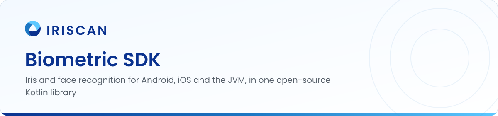
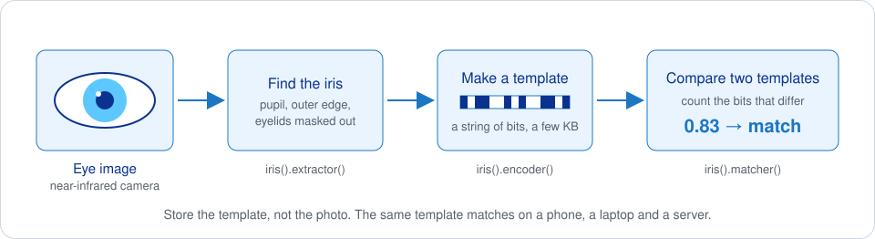
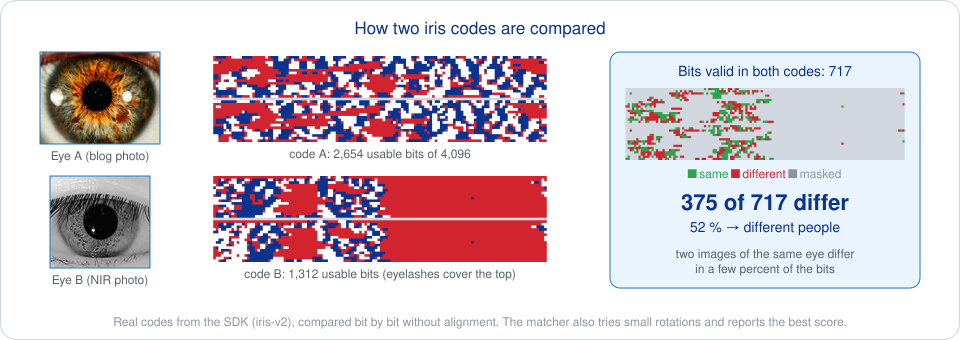

# Biometric SDK

An open-source library that recognizes people by their iris or their face, and runs on Android, iOS and the JVM from one Kotlin code base. You give it an eye image or a selfie; it gives you a compact template and a yes-or-no answer to "is this the same person?". Nothing leaves the device or your server: there is no cloud call anywhere in the code.

Iriscan uses the same code in its own products, and the face match of this SDK is the one that runs inside [Inji Wallet](https://docs.iriscan.com/mosip), the reference wallet of MOSIP, the open-source national ID platform.


[](https://search.maven.org/search?q=g:%22net.iriscan%22%20AND%20a:%22biometric-sdk%22)
[](https://search.maven.org/search?q=g:%22net.iriscan%22%20AND%20a:%22biometric-sdk-jvm%22)
[](https://search.maven.org/search?q=g:%22net.iriscan%22%20AND%20a:%22biometric-sdk-android%22)
[](https://cocoapods.org/pods/BiometricSdk)
[](https://GitHub.com/biometric-technologies/biometric-sdk/releases/)
[](LICENSE.md)

## What it does

- Turns a near-infrared photo of an eye into an iris template and compares two templates. The whole iris pipeline is plain Kotlin, so it behaves the same on every platform and needs no native libraries.
- Finds a face in a photo, turns it into an embedding with a FaceNet-type model and compares embeddings. Uses ML Kit on Android, Apple Vision on iOS and OpenCV on the JVM to find the face, and TensorFlow Lite to run the model.
- Checks that a face is live, not a printed photo or a screen, with a liveness model, and tells which way the head is turned.
- Reads and writes PNG and BMP images and converts to and from Bitmap, UIImage and BufferedImage.
- Serializes templates as ISO/IEC 19794-6 (iris image) and ISO/IEC 19794-2 (finger minutiae) records, the formats other biometric systems understand.



## Quick start

Add the dependency. Replace `0.6.0` with the latest version shown in the badges.

```kotlin
// Android
implementation("net.iriscan:biometric-sdk-android:0.6.0")

// JVM
implementation("net.iriscan:biometric-sdk-jvm:0.6.0")
```

```ruby
# iOS, Podfile
pod 'BiometricSdk', '~> 0.6.0'
```

Configure once, then compare two eye images:

```kotlin
import net.iriscan.sdk.BiometricSdkFactory
import net.iriscan.sdk.iris.*

val config = BiometricSdkFactory.configBuilder()
    .withContext(applicationContext)                 // Android only
    .withIris(
        extractor = IrisExtractProperties(),
        encoder = IrisEncodeProperties(),
        matcher = IrisMatchProperties(threshold = 0.67),
    )
    .build()
BiometricSdkFactory.initialize(config)
val sdk = BiometricSdkFactory.getInstance()!!

val eye1 = sdk.io().readImage(bytesOfFirstPhoto)
val eye2 = sdk.io().readImage(bytesOfSecondPhoto)

val template1 = sdk.iris().encoder().extractAndEncode(eye1)   // ByteArray, a few kilobytes
val template2 = sdk.iris().encoder().extractAndEncode(eye2)

val samePerson = sdk.iris().matcher().matches(template1, template2)
```

Store `template1` instead of the photo: it is what you compare against next time, and the photo cannot be rebuilt from it.

Face comparison works the same way, with the model file supplied by you:

```kotlin
import net.iriscan.sdk.face.*

val config = BiometricSdkFactory.configBuilder()
    .withContext(applicationContext)
    .withFace(
        extractor = FaceExtractProperties(),
        encoder = FaceEncodeProperties(
            FaceNetModelConfiguration(
                path = "https://example.com/models/facenet.tflite",  // URL or local file
                inputWidth = 160, inputHeight = 160, outputLength = 128,
                modelChecksum = null, modelChecksumMethod = null, overrideCacheOnWrongChecksum = null,
            )
        ),
        matcher = FaceMatchProperties(threshold = 1.0),
        liveness = null,
    )
    .build()
BiometricSdkFactory.initialize(config)
val sdk = BiometricSdkFactory.getInstance()!!

val face1 = sdk.face().encoder().extractAndEncode(nativeImage1)   // Bitmap, UIImage or BufferedImage
val face2 = sdk.face().encoder().extractAndEncode(nativeImage2)
val samePerson = face1 != null && face2 != null && sdk.face().matcher().matches(face1, face2)
```

Models are downloaded once and cached on the device. Working example apps: [Android](https://github.com/biometric-technologies/biometric-sdk-android-example), [iOS](https://github.com/biometric-technologies/biometric-sdk-ios-example) and [React Native](https://github.com/biometric-technologies/biometric-sdk-react-native).

## How it works

**Iris.** The iris is the colored ring around the pupil. Its texture is formed before birth, does not change with age and differs even between identical twins and between a person's two eyes, which is why it is the most accurate biometric in everyday use. The SDK finds the pupil and the outer edge of the iris in the image, masks out eyelids and reflections, unwraps the ring into a rectangular strip and turns the texture of the strip into a string of bits, the iris code (release 0.6.0 compares neighboring pixels into local binary patterns; the new pipeline in pull request #6 uses log-Gabor filters, the classic iris-code method). Two codes are compared by counting the bits that differ, ignoring masked areas; the SDK reports a similarity between 0 and 1 and calls it a match above the threshold you configured. Iris cameras use near-infrared light, which makes the texture visible even in dark eyes, so the algorithm expects NIR images.



The pictures above are real output of the iris pipeline on the iris photo from our blog and on a [near-infrared eye photo](https://commons.wikimedia.org/wiki/File:IRiris.jpg) by Boodlemason (Wikimedia Commons, CC BY-SA 3.0); the figure files are under the same license.

**Face.** The platform's face detector finds the largest face and its eyes, the SDK crops and aligns it, and a FaceNet-type neural network turns the crop into a list of numbers called an embedding. Faces of the same person give embeddings that are close together; the matcher measures the distance and compares it with the threshold. The network is a TensorFlow Lite file that you choose and host, so you can replace it with a better one without touching the SDK. The liveness check runs a second model on the face crop and returns a score; the position check uses the detector's head angles.

**Templates, not photos.** A template is small, cannot be turned back into the image, and is what you keep in your database. The ISO/IEC 19794 serializers let you exchange records with other vendors' software instead of being locked in.

More detail, including configuration parameters and per-platform notes, is on [docs.iriscan.com](https://docs.iriscan.com/).

## Accuracy

Release 0.6.0 contains the first generation of the iris encoder. A new iris pipeline with segmentation tuned on public datasets and image quality assessment based on ISO/IEC 29794-6 is in [pull request #6](https://github.com/biometric-technologies/biometric-sdk/pull/6) and will ship as 0.7.0; Iriscan measures it on CASIA-Iris-V4 and publishes a headline number with each release. Face accuracy depends on the model you supply.

## Where it is used

- Face match in [Inji Wallet](https://docs.iriscan.com/mosip), listed as compliant on the [MOSIP marketplace](https://marketplace.mosip.io/products/257).
- [Iriscan Cloud](https://www.iriscan.com/iris-recognition-sdk) and the Iriscan iris de-duplication server.
- Apps built with the [React Native wrapper](https://github.com/biometric-technologies/biometric-sdk-react-native).

## Related repositories

- [biometric-sdk-react-native](https://github.com/biometric-technologies/biometric-sdk-react-native): the same face match and liveness for React Native apps.
- [biometric-sdk-android-example](https://github.com/biometric-technologies/biometric-sdk-android-example) and [biometric-sdk-ios-example](https://github.com/biometric-technologies/biometric-sdk-ios-example): minimal apps that enroll and identify.
- [biometric-sdk-cocoapods-release](https://github.com/biometric-technologies/biometric-sdk-cocoapods-release): the prebuilt iOS framework behind the pod.
- [liveness-detection-model](https://github.com/biometric-technologies/liveness-detection-model): training code and released liveness models.
- [biometric-converter](https://github.com/biometric-technologies/biometric-converter): fingerprint images to ISO and ANSI minutiae templates.
- [docs](https://github.com/biometric-technologies/docs): source of the developer documentation.

## Building

```sh
./gradlew build          # JVM and Android
./gradlew podPublishXCFramework   # iOS framework, on macOS with Xcode
```

Releases are published to Maven Central by the `release` workflow and to CocoaPods from the cocoapods-release repository.

## License

GNU General Public License v3.0, see [LICENSE.md](LICENSE.md). You can use, change and redistribute the SDK freely as long as your software is open source under the same terms. For a closed-source product, Iriscan offers a [commercial license](https://www.iriscan.com/commercial-license).

## Contact

Bugs and feature requests: [open an issue](https://github.com/biometric-technologies/biometric-sdk/issues). Everything else: info@iriscan.net, https://www.iriscan.com.
